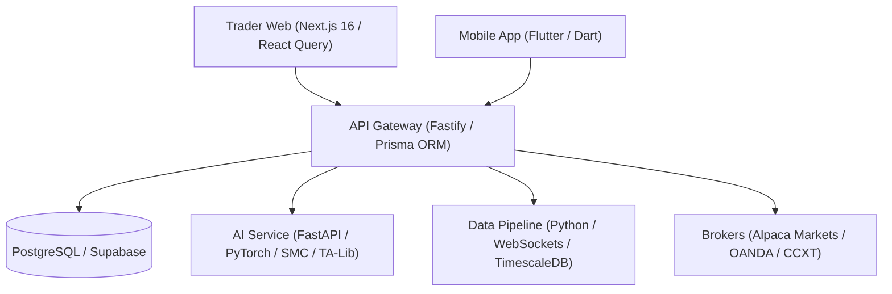

# QuantroApex — Autonomous AI Trading Platform

QuantroApex is an institutional multi-asset algorithmic trading, paper simulation, manual execution desk, and risk vault platform developed by **Quantro Software Labs**.

---

## 🏛️ Architecture & System Design

QuantroApex is built as a modular microservices monorepo:



---

## 📚 Component Documentation Index

| Component | Path | Description | Tech Stack |
|-----------|------|-------------|------------|
| **Trader Web** | [`apps/trader-web`](./apps/trader-web/README.md) | Institutional desktop trading client | Next.js 16, React 19, Tailwind CSS |
| **Mobile App** | [`apps/mobile`](./apps/mobile/README.md) | Cross-platform trading & AI advisory app | Flutter 3.22, Dart, Riverpod |
| **API Gateway** | [`services/api-gateway`](./services/api-gateway/README.md) | Main backend server, auth & risk enforcer | Fastify, TypeScript, Prisma ORM |
| **AI Service** | [`services/ai-service`](./services/ai-service/README.md) | SMC overlays, TA-Lib, VectorBT engine | Python 3.11, FastAPI, PyTorch |
| **Data Pipeline** | [`services/data-pipeline`](./services/data-pipeline/README.md) | Real-time market streaming & model pre-training | Python, WebSockets, TimescaleDB |
| **Quant Engine** | [`services/quant-engine`](./services/quant-engine/README.md) | Legacy TA-Lib & backtest service | FastAPI, VectorBT |
| **Load Tests** | [`scripts/load-tests`](./scripts/load-tests/README.md) | 500-user concurrency stress testing | k6 |

---

## 🚀 Quick Start (Local Setup)

### 1. Prerequisites

- **Node.js**: `>= 20.0.0`
- **pnpm / npm**: `npm >= 10`
- **Python**: `>= 3.11`
- **Flutter**: `>= 3.22` (optional, for mobile app development)

### 2. Environment Configuration

Copy the template file to set up environment variables:

```bash
cp .env.example .env
```

### 3. Install Dependencies & Migrate Database

```bash
# Install root & gateway dependencies, run Prisma migrations
npm run setup
```

### 4. Running Microservices

Start individual services locally:

- **API Gateway**: `npm run dev` (starts Fastify on `http://localhost:3000`)
- **Trader Web**: `npm run trader:dev` (starts Next.js on `http://localhost:3001`)
- **AI Service**: `npm run ai:dev` (starts FastAPI on `http://localhost:8001`)
- **Data Pipeline**: `npm run data:api` (starts Python service on `http://localhost:8002`)

### 5. Running Tests

```bash
# Run unit and integration tests across microservices
npm test
```

---

## 🔒 Institutional Security & Risk Vault

QuantroApex enforces server-side risk controls prior to order submission:
- **Daily Loss Limit**: Automatic trading pause when cumulative daily losses breach configured limits.
- **Max Drawdown Fail-Safe**: Immediate emergency position flattening upon equity drawdown threshold breach.
- **Per-Trade Sizing Caps**: Hard risk caps per single trade execution.
- **KYC & Subscription Gating**: Live order routes require verified identity (Sumsub) and active subscription status (Paystack).

---

## 📄 License

Copyright © 2026 **Quantro Software Labs**. All rights reserved.
