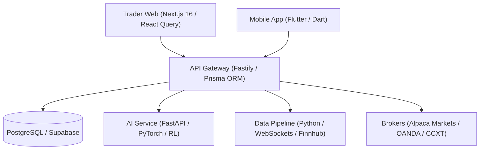

# QuantroApex — Autonomous AI Trading System

QuantroApex is an autonomous multi-asset algorithmic trading, paper simulation, manual trading, and institutional risk-vault platform developed by **Quantro Software Labs**.

---

## 🏛️ Architecture & Stack Overview

QuantroApex is built as a modular micro-service architecture:



### Stack Summary
- **Apps**:
  - `apps/trader-web`: Modern Next.js 16 desktop interface (TypeScript, TailwindCSS, React Query).
  - `apps/mobile`: Flutter cross-platform client (iOS, Android, Web).
- **Services**:
  - `services/api-gateway`: Fastify Node.js server, Prisma ORM, Firebase Auth, Sumsub KYC, Paystack Webhooks, Risk Vault.
  - `services/data-pipeline`: Python real-time WebSocket market streaming engine & paper trading simulator (port `:8002`).
  - `services/ai-service`: Python FastAPI strategy inference & sentiment engine (port `:8001`).
- **Database**: PostgreSQL (Prisma ORM) with Supabase connection pooling.

---

## 🚀 Quick Start (Local Setup)

### 1. Prerequisites
- **Node.js**: `>= 20.0.0`
- **pnpm / npm**: `npm >= 10`
- **Python**: `>= 3.11`
- **Flutter**: `>= 3.22` (for mobile app)

### 2. Environment Setup
Copy the environment template:
```bash
cp .env.example .env
```

### 3. Install & Sync Database
```bash
# Install dependencies and sync database schema
npm run setup
```

### 4. Running Microservices
- **API Gateway**: `npm run dev` (starts Fastify on `http://localhost:3000`)
- **Trader Web**: `npm run trader:dev` (starts Next.js on `http://localhost:3001`)
- **AI Service**: `npm run ai:dev` (starts FastAPI on `http://localhost:8001`)
- **Data Pipeline**: `npm run data:api` (starts Python service on `http://localhost:8002`)

### 5. Run Test Suite
```bash
npm test
```

---

## 🔒 Security & Risk Vault

QuantroApex enforces multi-tier server-side risk controls prior to order execution:
- **Daily Loss Limit**: Automatic pause when cumulative daily losses breach limit.
- **Max Drawdown Protection**: Fail-closed Emergency Stop triggered dynamically on post-fill equity drawdown.
- **Per-Trade Exposure**: Restricts maximum position size per trade.
- **KYC & Subscription Gating**: Live mode orders require verified identity (Sumsub) and active subscription (Paystack).
